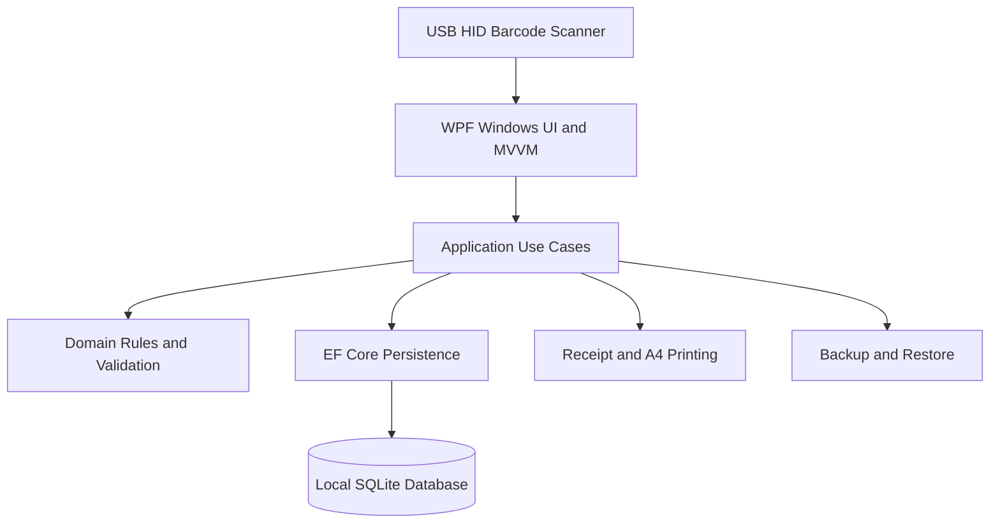

# Product Requirements Document (PRD)

## StoreFlow Desktop — Retail Store Management, Inventory & Point of Sale

| Document field | Details |
|---|---|
| Working product name | StoreFlow Desktop |
| Document type | Product Requirements Document (PRD) |
| Version | 1.0 — Implementation Draft |
| Prepared on | October 25, 2026 |
| Target platform | Windows desktop |
| Database | Local SQLite |
| Operating model | Offline-first; core workflows require no internet connection |
| Document language | English |
| Application language | Arabic (RTL) initially; localization-ready for English |
| Default currency | Egyptian pound (EGP), configurable |
| Initial deployment | One retail store, one local PC / POS terminal |
| Status | Proposed requirements; scope decisions must be confirmed before implementation |

> **Core assumption:** The business type has not been specified. This PRD therefore targets a general small-to-medium retail shop selling stock-tracked goods (e.g., accessories, household supplies, clothing, or general merchandise). Batch/expiry tracking, weighed goods, serial-number tracking, product variants, and multi-branch operations are not mandatory for the MVP.

---

## 1. Executive Summary

Build a reliable, fast, offline Windows application that manages products, stock, purchasing, barcode-assisted sales, invoices, returns, and management reports in one place. It must protect financial and inventory consistency, work with common USB barcode scanners, print sales receipts, and support verified backups and restoration.

### 1.1 Problem Statement

Small retail shops frequently face:

- Slow and error-prone manual checkout and invoicing.
- Unreliable stock quantities and discrepancies between physical stock and recorded stock.
- Poor visibility into product costs, gross margins, and best-selling items.
- Sales records being altered without an audit trail.
- Lack of clear purchase, return, discount, and inventory-movement reports.
- Risk of permanent data loss when an offline PC or its disk fails.

### 1.2 Product Goal

Provide a single application in which a shop owner can create a product, receive stock, scan items, finish a sale, issue a receipt, process a return, count stock, and understand store performance.

### 1.3 Initial Success Metrics

| Metric | Initial acceptance target |
|---|---|
| Add a known barcode to the cart | Under 1 second on specified reference hardware in normal conditions |
| Create a five-line sale using barcodes | At most 30 seconds for a trained cashier, excluding customer payment and printer time |
| Inventory consistency | 100% reconciliation between posted stock ledger movements and reported on-hand quantity |
| Offline checkout | Available whenever the PC and local database are operational |
| Product listing performance | Open in at most 2 seconds with 10,000 test products on reference hardware |
| Backup reliability | Periodic restoration to a separate test environment succeeds and passes integrity checks |

These are proposed targets, not previously measured performance results.

---

## 2. Product Scope

### 2.1 MVP — Must Have (P0)

1. Local authentication, user accounts, and basic role-based permissions.
2. Store, currency, taxes, invoice, and printer settings.
3. Product and category management, SKUs, sales prices, cost prices, and barcodes.
4. Product CSV import/export and report CSV export.
5. Supplier management and purchase receiving that updates available stock.
6. Stock balances, movement ledger, low-stock alerts, stocktaking, and authorized adjustments.
7. Fast POS screen: barcode scan, product lookup, cart, discounts, tax, payment, and receipt printing.
8. Posted sales invoices, detailed history, and safe receipt reprinting.
9. Partial and full sales returns linked to original invoices.
10. Sales, gross profit, inventory, purchasing, best sellers, and returns reports.
11. Local audit trail, safe backups, and tested restore functionality.

### 2.2 Phase 2 — Should Have (P1/P2)

- Customer profiles, credit sales, part payments, and customer balances.
- Cash drawer / cashier shift opening, closing, and cash variance reports.
- In-app barcode label generation and printing.
- Promotions, bundles, coupons, and quotations.
- Product variants such as sizes and colors, each with its own barcode.
- Expiry dates, lot/batch tracking, and FEFO handling where needed.
- Additional financial analytics and PDF/XLSX reports.
- English interface and customizable keyboard shortcuts.
- Multiple barcodes per product and more advanced scanner configuration.

### 2.3 Explicitly Out of Scope for MVP

- Mobile or web applications, hosted cloud sync, and multi-device collaboration.
- Running multiple cashier PCs against one SQLite file over a network share.
- Multiple branches, multiple stock locations, or inter-warehouse transfers.
- Full accounting/general ledger, payroll, or expense management.
- Automatic integration with Egyptian tax authority e-invoicing/e-receipt systems.
- Bank payment terminal or online payment gateway integration.
- Digital scale integrations and weighted-barcode handling.
- Manufacturing, BOM/kits, or per-item serial-number tracking.

> **Compliance note:** A printed POS receipt or a locally generated invoice is not automatically a legally approved electronic tax invoice or e-receipt. Confirm applicable Egyptian tax requirements for the actual business before production use.

---

## 3. Users, Roles & Permissions

| Role | Main responsibility | Typical permissions |
|---|---|---|
| Owner / Admin | Manage and oversee the shop | Full product, purchase, inventory, settings, user, reporting, and backup access |
| Cashier | Perform fast retail checkout | Scan, create sales, collect payment, print receipts, view permitted invoices, request return/override approval |
| Inventory Clerk | Receive and count inventory | Receive purchases, count inventory, review stock movements, perform permitted adjustments without access to sensitive margins by default |

**Mandatory permission rules**

- Authenticate locally. Store passwords using a password-specific hash (for example, Argon2id or properly configured PBKDF2), never plaintext or reversible encryption.
- Enforce authorization in application commands/services, not just by hiding buttons.
- Require manager approval or re-authentication for discounts above policy limits, sensitive price overrides, large stock adjustments, and database restoration.
- Assign stable user IDs to actions; do not use changeable display names as audit identifiers.
- Deactivate users with transaction history rather than deleting them.

---

## 4. Core User Journeys

### 4.1 Create a Product

1. An authorized employee opens Products and selects **New Product**.
2. Enters name, category, unit, purchase cost, selling price, and reorder level.
3. Scans or enters a barcode; the application checks uniqueness.
4. Saves the active product.
5. The item becomes immediately searchable and scannable on the POS screen.

### 4.2 Receive Purchased Goods

1. Select a supplier.
2. Add products, quantities, and actual acquisition costs.
3. Save the purchase document as a draft; stock does not change yet.
4. Review and post/receive the document.
5. The system atomically posts positive stock movements, updates valuation, and records the document number, user, and timestamp.

### 4.3 Barcode Checkout

1. Open the POS screen; the barcode input is focused.
2. Scan the item with a USB HID/keyboard-wedge scanner.
3. The item enters the cart; repeated scans increment quantity on the existing line according to one consistent cart policy.
4. The cashier reviews quantity, price, discounts, taxes, and total.
5. The cashier selects a payment method and enters cash received when relevant.
6. The cashier confirms checkout.
7. One database transaction posts the invoice, payment record, stock movements, and cost-of-goods-sold (COGS) snapshots.
8. The app displays a successful sale and offers receipt printing. Printer errors never create a second sale.

### 4.4 Process a Sales Return

1. Find the original invoice by number or invoice lookup.
2. Select returned lines, quantities, and reason.
3. Verify cumulative returned quantities never exceed originally sold quantities.
4. Mark items as **resellable** or **damaged**.
5. Post a return document linked to the original invoice and record the actual refund and refund method.
6. Increase saleable stock only for resellable items. Damaged items are recorded separately and never automatically become saleable.

### 4.5 Stocktake and Adjustment

1. Start a stock count session.
2. Capture the current book quantity for each selected product.
3. Enter the observed physical count.
4. Display quantity and estimated value differences.
5. Require an authorized approval and an adjustment reason.
6. Post auditable stock movements; never silently overwrite existing balances.

---

## 5. Functional Requirements

Priority definitions: **P0** = mandatory for MVP; **P1** = desirable after core workflows; **P2** = later enhancement.

### 5.1 General Settings & Users

| ID | Requirement | Priority | Acceptance criteria |
|---|---|---|---|
| GEN-01 | Configure store name, address, telephone, and logo | P0 | Enabled details appear on invoices/receipts |
| GEN-02 | Manage users, roles, and permissions | P0 | Unauthorized actions are rejected at the application-service layer |
| GEN-03 | Login, logout, and session lock | P0 | Protected operations require an active authorized session |
| GEN-04 | Configure currency formatting and default tax policy | P0 | Posted invoices retain their historical calculation settings |
| GEN-05 | Configure thermal/A4 printers and print preview | P0 | Admin can select, save, and test the selected printer |
| GEN-06 | Dashboard with basic KPIs | P1 | Shows daily sales, invoice count, and low-stock items |

### 5.2 Product Management

**Required product attributes:** permanent ID, unique SKU, name, selling unit, category, sale price, opening/initial cost (or first purchase valuation), and active state.

**Optional attributes:** barcode, local image, description, reorder threshold, tax rate/category, default discount, created/updated timestamps.

| ID | Requirement | Priority | Acceptance criteria |
|---|---|---|---|
| PRD-01 | Create, edit, and deactivate products | P0 | Deactivated products cannot be added to new sales; history remains intact |
| PRD-02 | Search by name, SKU, or barcode | P0 | Results support keyboard selection |
| PRD-03 | Enforce unique SKU and barcode | P0 | Conflicts prevent save and display an actionable message |
| PRD-04 | Product categories | P0 | Each product has a primary category or explicit Uncategorized value |
| PRD-05 | Sale price and cost tracking | P0 | Historical invoices never change when the current product price changes |
| PRD-06 | CSV import with preview and row-level error reporting | P0 | Invalid rows are identified before import; changes are previewable |
| PRD-07 | Locally stored product pictures | P1 | Images referenced by products are included in backup scope |
| PRD-08 | Multiple barcodes for one product | P2 | A barcode cannot belong to two different active products |

**Business rules**

- The MVP supports stocked goods; non-stock services require a separate scope decision.
- Default sale unit is **piece**. Quantity precision is configured by unit when fractional quantities are enabled.
- Until variants are implemented, sizes and colors may be separate product records.
- Products referenced by any posted financial or inventory document cannot be hard-deleted; deactivate instead.
- Store barcodes as text, preserving leading zeros.

### 5.3 Suppliers & Purchases

| ID | Requirement | Priority | Acceptance criteria |
|---|---|---|---|
| PUR-01 | Supplier records: name, contact number, notes | P0 | Supplier can be searched and reused on purchase documents |
| PUR-02 | Multi-line draft purchase document | P0 | Saving/editing a draft does not change inventory |
| PUR-03 | Post goods receipt | P0 | Stock increases exactly once and movements reference the source document |
| PUR-04 | Cost price recorded on every purchase line | P0 | Valuation updates according to the agreed stock-cost policy |
| PUR-05 | Purchase register with filters and CSV export | P0 | Searchable by document number, supplier, and date |
| PUR-06 | Reverse/correct posted purchases with authorization | P1 | Creates traceable reversing entries rather than deleting history |

Purchases in the MVP are **goods receipt and cost records**, not a complete accounts-payable or supplier credit-payment module.

### 5.4 Inventory Control

| ID | Requirement | Priority | Acceptance criteria |
|---|---|---|---|
| INV-01 | Current on-hand quantity per product | P0 | Matches posted inventory movements |
| INV-02 | Stock movement ledger | P0 | Displays signed quantity, source, reason, user, and timestamp |
| INV-03 | Reorder levels and low-stock alerts | P0 | Flag products at or below configured threshold |
| INV-04 | Block sales that exceed available stock | P0 | Sale is fully rejected without creating a partial invoice or stock deduction |
| INV-05 | Stock count and approved adjustments | P0 | Physical count does not change posted stock until approval |
| INV-06 | Opening stock balances | P0 | Recorded as auditable opening movements, not direct balance edits |
| INV-07 | Inventory valuation report | P0 | Shows quantity and value using agreed valuation policy and report date |
| INV-08 | Damaged/non-saleable stock handling | P1 | Damaged returns never inflate available-to-sell stock |

**Inventory invariants**

1. `StockMovements` is the authoritative posted quantity ledger; optional cached `StockBalances` are updated in the same transaction and reconciled periodically.
2. Negative available stock is prohibited for the MVP.
3. Posted movements are immutable; authorized corrections create referenced reversing/adjustment entries.
4. Stock counts do not alter selling prices.
5. Sales posting is all-or-nothing: invoice, payment, stock, and valuation must either all commit or all roll back.

### 5.5 Point of Sale (POS)

| ID | Requirement | Priority | Acceptance criteria |
|---|---|---|---|
| POS-01 | Continuous barcode scanning and product search | P0 | Complete scan with configured Enter/Tab terminator adds item |
| POS-02 | Cart editing: quantity, remove line, totals | P0 | Totals update immediately without posting inventory before checkout |
| POS-03 | Fixed/percentage line and invoice discounts | P0 | Authorization limits apply; total cannot become negative |
| POS-04 | Configurable taxation | P0 | Totals reconcile with prices, discounts, tax basis, and rounding rules |
| POS-05 | Record cash/card/other payment method | P0 | Method is stored; no claim of external processor authorization |
| POS-06 | Cash received and customer change | P0 | Immediate checkout rejects insufficient cash |
| POS-07 | Unique sequential local invoice numbers | P0 | Repeated Save/Confirm actions do not create duplicate sales |
| POS-08 | 80 mm thermal and A4 receipts/invoices | P0 | Reprinting cannot post another transaction |
| POS-09 | Suspend/hold a cart | P1 | Suspended cart does not reserve or deduct stock |
| POS-10 | Keyboard-first checkout shortcuts | P1 | Cashier can complete normal checkout without a mouse |

**Calculation and posting rules**

- Display **Subtotal → Discount → Tax → Grand Total → Paid → Change**.
- Define whether prices are tax-inclusive or tax-exclusive and use the policy consistently.
- Each posted invoice line stores immutable snapshots of product name, SKU, barcode, unit price, discount, tax, and unit COGS.
- Use a decimal-safe money representation and an explicit rounding policy; do not calculate money using `float`/`double`.
- Checkout is idempotent using a unique `client_operation_id` so a double click or retry cannot create duplicate invoices.
- Sales must be fully paid at posting time in the MVP; customer credit is a later feature.

### 5.6 Barcode Scanners & Hardware

| ID | Requirement | Priority | Acceptance criteria |
|---|---|---|---|
| BAR-01 | USB HID / keyboard-wedge scanner support | P0 | Scanning a known code adds the correct product |
| BAR-02 | Configurable Enter/Tab scan suffix | P0 | Partial/unfinished scans cannot trigger checkout additions |
| BAR-03 | Unknown barcode handling | P0 | Show understandable error and manual search option; never silently create products |
| BAR-04 | Manual barcode entry | P0 | Checkout remains usable if a scanner is disconnected |
| BAR-05 | EAN-13, UPC-A, and Code 128 scenarios | P1 | Recognized codes remain text; optional symbology validation behaves as configured |
| BAR-06 | Barcode label printing | P2 | Layout preview and actual output tested on a nominated label printer |

Keyboard-wedge scanners are the MVP target. Serial/COM-port scanners and manufacturer-specific SDKs require additional implementation and testing.

### 5.7 Sales Invoices & Returns

| ID | Requirement | Priority | Acceptance criteria |
|---|---|---|---|
| SAL-01 | Sales invoice history and details | P0 | Search by invoice number, date, and cashier |
| SAL-02 | Reprint receipts; optionally mark COPY | P0 | Reprint does not affect inventory or revenue |
| SAL-03 | Partial/full return referencing original invoice | P0 | Cumulative returns cannot exceed the original posted sold quantity |
| SAL-04 | Capture return reason and item condition | P0 | Reason, disposition, user, and timestamp are auditable |
| SAL-05 | Record cash/other refund method and amount | P0 | Refund is documented without assuming automatic bank processing |
| SAL-06 | Protect posted invoices from direct edits | P0 | Corrections use controlled returns/reversals with an audit trail |

**Invoice cancellation policy**

- Never physically delete a posted sales invoice.
- Unposted drafts may be abandoned without stock or money impact.
- Posted documents are reversed/returned using an authorized linked document.
- Preserve original revenue and COGS snapshots for accurate return accounting.

### 5.8 Reports & Analytics

| ID | Report | Filters | Required information | Priority |
|---|---|---|---|---|
| REP-01 | Daily sales summary | Date range, cashier | Gross sales, discounts, tax, returns, net sales, invoice count | P0 |
| REP-02 | Sales by product | Date range, category | Quantity, net revenue, COGS, gross profit | P0 |
| REP-03 | Best-selling products | Date range, top N | Ranking by units or revenue | P0 |
| REP-04 | Stock on hand | Category, status | Quantity, reorder threshold, unit cost, stock value | P0 |
| REP-05 | Low/out-of-stock | Category | Current quantity and reorder threshold | P0 |
| REP-06 | Stock movement history | Date, product, type | Movement type, quantity, balance, reason, source document | P0 |
| REP-07 | Purchasing | Date range, supplier | Purchase quantities and costs | P0 |
| REP-08 | Gross profit | Date range, category | Net sales excluding output tax minus net COGS | P0 |
| REP-09 | Returns | Date range, cashier, product | Counts, amounts, and reasons | P0 |
| REP-10 | Export reports to CSV | All core reports | UTF-8 with BOM for correct Arabic text in Excel | P0 |
| REP-11 | Cashier shift reconciliation | Shift, cashier | Cash opening/closing values and variance | P1 |

**Financial definition:**

`Gross Profit = Net Sales Revenue (excluding output tax) − Cost of Goods Sold (COGS) for net sold quantities`

Gross profit is **not** net profit. Rent, salaries, utilities, operational costs, and general expenses are not deducted by this MVP report. Label reports accordingly.

---

## 6. Costing, Tax & Time Policies

### 6.1 Proposed Stock Valuation Policy

**Recommended for MVP: moving weighted-average unit cost.**

Example:

- Existing stock: 10 pieces × EGP 50 = EGP 500.
- New receipt: 10 pieces × EGP 70 = EGP 700.
- Updated average cost: EGP 1,200 ÷ 20 = **EGP 60 per unit**.
- Sale of 3 pieces records **EGP 180 COGS** and preserves this value on the invoice lines.

**Required safeguards**

- Do not casually backdate posted inventory documents if doing so would silently change historical costing.
- Returns reverse original COGS using the cost captured at sale; the effect of returned stock on moving average must follow an explicit, reconciled valuation rule.
- Stocktake differences use a documented unit cost and are reported separately from sales revenue.
- Editing a product's current cost must not recalculate margins on previously posted invoices.

### 6.2 Tax

- Allow taxes to be disabled or configured using appropriate rates/categories.
- Define inclusive versus exclusive selling prices and deterministic calculation/rounding.
- Retain tax values on posted invoices even after settings change.
- Do not assume all merchandise has identical tax treatment.
- Do not represent this product as tax-authority-compliant without a separate compliance project.

### 6.3 Dates & Time

- Store actual transaction timestamps in UTC and display them in the user's configured local time zone.
- Separate user-facing document date from the actual posting timestamp.
- Preserve user and audit data; acknowledge that a standalone offline PC clock is not independently tamper-proof.

---

## 7. UX/UI Requirements

### 7.1 Product Experience Principles

- Arabic RTL UI by default, with clear number and currency formats. Keep localization feasible by externalizing display strings.
- Make POS the fastest path: persistent scanner input, high-contrast total, and readable cart lines.
- Never communicate critical status with color alone (e.g., low stock versus inactive).
- Offer drafts for lengthy data entry; clearly confirm irreversible posting.
- Display actionable error messages rather than raw exception text.
- Support keyboard navigation, logical tab order, and Windows text scaling.

### 7.2 Required MVP Screens

1. Splash / database initialization / first-run setup.
2. Login and session lock.
3. Dashboard.
4. Product list, create/edit product, and CSV import.
5. Categories.
6. Suppliers.
7. Purchase list, purchase draft/details, and receive action.
8. Stock overview, movements, stock count, and adjustments.
9. POS, checkout, receipt/success screen.
10. Sales invoices, invoice details, and sales returns.
11. Reports with date filters and CSV export.
12. Users and roles.
13. Settings for store details, currency, tax, and printing.
14. Backup, restore, and audit log.

### 7.3 POS Wireframe (Conceptual)

```text
+------------------------------------------------------------------------------+
| StoreFlow     Cashier: Ahmed        Date/Time        New Invoice             |
+------------------------------------------------------------------------------+
| [ Scan barcode or search product...                              ] [Search]  |
+------------------------------------------------+-----------------------------+
| Product         Qty      Unit Price      Total  | Subtotal:           800.00 |
| Water            2           15.00       30.00 | Discount:            20.00 |
| Detergent        1          150.00      150.00 | Tax:                  0.00 |
| ...                                            | Amount due:         780.00 |
|                                                | [Cash] [Card] [Other]       |
| [Remove] [Change Qty] [Hold Sale]               | [ Confirm Sale ]            |
+------------------------------------------------+-----------------------------+
```

The numeric amounts above are UI placeholders, **not** an internally reconciled example invoice.

---

## 8. Technical Architecture

### 8.1 Recommended Stack

| Area | Recommended technology | Rationale |
|---|---|---|
| Windows UI | WPF + XAML | Mature native desktop support and printer/hardware integration |
| Language & runtime | C# + .NET 10 LTS | Maintained .NET LTS release and strong Windows ecosystem |
| UI pattern | MVVM using CommunityToolkit.Mvvm | Clean separation between views, UI state, and workflows |
| Application layer | Use-case services / commands | One place for sale, purchase, stock, and authorization workflows |
| Domain layer | Entities, value objects, business policies | Isolates financial and inventory rules from UI |
| Persistence | SQLite + EF Core SQLite provider | Small offline footprint and transactional storage |
| Validation | FluentValidation or dedicated validators | Shared and testable input/business validation |
| Logging | Serilog or equivalent | Diagnosable local logs and safe error reporting |
| Automated tests | xUnit and SQLite-backed integration tests | Tests important transactional and valuation behavior |
| Installer | MSI or MSIX, selected after device testing | Reliable installation, updates, and uninstallation |

Use **pragmatic Clean Architecture**, not layers of unnecessary generic abstractions. Keep domain calculations and stock posting independent of WPF so they can be tested in isolation.

### 8.2 High-Level System Diagram



### 8.3 Suggested Solution Structure

```text
StoreFlow/
├── src/
│   ├── StoreFlow.Desktop/               # WPF views, viewmodels, navigation
│   ├── StoreFlow.Application/           # Use cases, DTOs, authorization
│   ├── StoreFlow.Domain/                # Entities, business policies, calculations
│   └── StoreFlow.Infrastructure/        # EF Core, SQLite, printing, backups, logs
├── tests/
│   ├── StoreFlow.Domain.Tests/
│   ├── StoreFlow.Application.Tests/
│   ├── StoreFlow.Integration.Tests/
│   └── StoreFlow.Desktop.SmokeTests/
├── installer/
└── README.md
```

### 8.4 SQLite Design Decisions

- Store the database in an appropriate writable Windows application-data location, **not** alongside the executable under `Program Files`.
- Enable and test SQLite foreign-key enforcement on every connection.
- Assess WAL mode against deployment, failure, and backup needs. Never assume a raw `.db` copy made during active writes is a safe backup.
- Use SQLite's online backup API or a similarly safe supported method, and verify integrity before marking a backup successful.
- Configure an appropriate busy timeout and short transactions. SQLite permits only one concurrent writer.
- Track schema migrations and back up the database before potentially destructive upgrades.
- **Do not host the SQLite database on SMB/network shared storage for multiple POS PCs.** Future multi-device support needs an API/service and appropriate centralized database (e.g., PostgreSQL or SQL Server).

### 8.5 Local Data Security & Backup

- Restrict data files and backups using Windows filesystem permissions.
- Never persist plaintext user passwords, recovery secrets, or payment card data.
- Schedule configurable automatic backups, e.g., daily backups with retention of the latest seven daily and four weekly copies.
- Allow backup to external media or a user-selected external directory. Same-disk backups alone are insufficient for disk failure.
- Encrypt portable backup archives with a strong password where feasible (recommended P1 if not included in MVP).
- Check backup integrity and test restoration before claiming success.
- Restrict restore to an authorized administrator, close active transactions, verify backup schema compatibility, and preserve a restore point when possible.
- Document a step-by-step recovery process for replacing a failed shop PC.

---

## 9. Initial Logical Data Model

This is an initial entity inventory, **not** the final SQL schema. Define field data types, composite indexes, foreign keys, and database constraints during technical design.

| Entity / Table | Key fields | Relationships / notes |
|---|---|---|
| `Users` | Id, Username, PasswordHash, RoleId, IsActive | Stable actor ID for every transaction |
| `Roles`, `Permissions`, `RolePermissions` | Id, Code, RoleId, PermissionId | Application-enforced authorization |
| `Categories` | Id, Name, IsActive | Product classification |
| `Products` | Id, SKU, Barcode, Name, CategoryId, UnitId, SalePrice, ReorderLevel, IsActive | Unique SKU; text barcode unique when present |
| `Units` | Id, Name, Precision | Controls fractional quantity precision |
| `Suppliers` | Id, Name, Phone, Notes | Referenced by purchases |
| `PurchaseDocuments` | Id, Number, SupplierId, Status, Total, ApprovedAt, UserId | Draft / Posted / Reversed |
| `PurchaseLines` | Id, PurchaseId, ProductId, Quantity, UnitCost, Tax, Total | Immutable historical acquisition cost on posted lines |
| `SalesInvoices` | Id, Number, Status, Subtotal, Discount, Tax, GrandTotal, UserId, PostedAt, OperationId | Unique operation ID for checkout idempotency |
| `SalesInvoiceLines` | Id, InvoiceId, ProductId, NameSnapshot, SKUSnapshot, BarcodeSnapshot, Quantity, UnitPrice, Discount, Tax, UnitCostSnapshot | Immutable sales/cost snapshots |
| `Payments` | Id, InvoiceId, Method, Amount, Reference | Records payment declaration, not bank approval |
| `SalesReturns` | Id, Number, OriginalInvoiceId, Reason, RefundAmount, UserId, PostedAt | Linked to original sale |
| `SalesReturnLines` | Id, ReturnId, InvoiceLineId, Quantity, Resellable, RefundAmount, OriginalUnitCost | Preserve original item value and disposition |
| `StockMovements` | Id, ProductId, DocumentType, DocumentId, QuantityDelta, UnitCost, CreatedAt, UserId, Reason | Immutable stock movement ledger |
| `StockBalances` | ProductId, QuantityOnHand, AvgUnitCost, Version | Derived cache consistent with ledger |
| `StockCounts`, `StockCountLines` | Id, Status, ProductId, ExpectedQty, CountedQty, Difference | Approvals and count history |
| `Settings` | Key, Value, UpdatedAt | Store preferences and configuration |
| `AuditLogs` | Id, ActorId, Action, EntityType, EntityId, Timestamp, BeforeHash, AfterSummary | Never log passwords or secrets |
| `BackupLogs` | Id, Path, CreatedAt, FileChecksum, Result | Backup integrity and outcome |

### 9.1 Data Integrity Rules

- Enforce `UNIQUE(Products.SKU)` and an appropriate unique index on non-empty barcodes.
- Enforce `UNIQUE(SalesInvoices.Number)` and `UNIQUE(SalesInvoices.OperationId)`.
- Enable foreign keys and use stable IDs rather than mutable names for relationships.
- Require positive quantities on purchase and sale lines; stock ledger carries signed deltas.
- Add `CHECK` constraints for simple bounds and enforce complex policies in the domain/application layers.
- Index SKU, barcode, document numbers, reporting dates, and stock movement product/date fields.
- Use explicit transactions and optimistic or suitable concurrency controls for posting and balance updates.

---

## 10. Non-Functional Requirements

| ID | Area | Acceptance criteria |
|---|---|---|
| NFR-01 | Offline use | All P0 workflows operate without internet access; optional updates excluded |
| NFR-02 | Operating system | Windows 11 x64; other Windows editions supported only after runtime and device testing |
| NFR-03 | Scan performance | Known barcode adds item in under 1 second on reference hardware |
| NFR-04 | Data volume | Validate performance with at least 10,000 products and 100,000 invoices plus representative movement history |
| NFR-05 | Transaction integrity | No successfully posted sale may lack its corresponding stock and payment records, or vice versa |
| NFR-06 | Authorization and security | Password hashing, role checks, audit trail, and privilege-escalation tests |
| NFR-07 | Crash recovery | Forced shutdown/power-loss tests leave committed-or-rolled-back transactional state |
| NFR-08 | Recoverability | Backup/restore succeeds on a different testing device or clean environment |
| NFR-09 | Printing | Physically test nominated 80 mm receipt printer and A4 printer during UAT |
| NFR-10 | Maintainability | Domain rules separate from UI, test coverage, and readable local diagnostics |
| NFR-11 | Usability | Keyboard-first POS, readable layouts, and clear Arabic user messages |
| NFR-12 | Updates and migration | Backup before sensitive DB migration; documented rollback/recovery plan |

**Suggested reference device (provisional):** a modern Intel Core i3 or equivalent, 8 GB RAM, SSD, Windows 11, and display resolution of 1366×768 or higher. Validate against actual shop equipment.

---

## 11. User Acceptance Testing (UAT)

| ID | Scenario | Expected result |
|---|---|---|
| UAT-01 | Create product with new barcode | Save, search, and scanner lookup succeed |
| UAT-02 | Create another product with same barcode | Validation error and no conflicting save |
| UAT-03 | Receive 10 units into zero stock | Stock becomes 10 and a +10 movement is recorded |
| UAT-04 | Sell 3 units by scanning | Exactly one invoice; stock becomes 7; movement -3; correct receipt |
| UAT-05 | Scan identical barcode twice | Single cart line increments to quantity 2 |
| UAT-06 | Attempt sale of 9 units with 7 available | Entire checkout rejected without invoice or stock change |
| UAT-07 | Double-click Confirm Sale | Only one invoice is created |
| UAT-08 | Disconnect printer after sale posts | Sale persists once and can be reprinted later |
| UAT-09 | Force app shutdown during posting | Everything commits or everything rolls back; no partial transaction |
| UAT-10 | Return 1 of 3 sold units | Linked return; resellable stock increases; correct refund recorded |
| UAT-11 | Attempt return of 4 from invoice of 3 | Excess return rejected |
| UAT-12 | Change product price after sale | Prior invoice values and profit remain unchanged |
| UAT-13 | Cashier attempts unauthorized discount | Action blocked or requires configured manager approval |
| UAT-14 | Stock count differs by 2, then approve | Tracked adjustment with correct final quantity |
| UAT-15 | Export report containing Arabic names | CSV opens correctly in Excel |
| UAT-16 | Back up then restore on clean test PC | Invoice counts, sales totals, and inventory figures reconcile |
| UAT-17 | Disconnect internet and make sale | Checkout and local printing still succeed |
| UAT-18 | Deactivate historically sold product | Historical documents remain readable and valid |
| UAT-19 | Receive higher-cost goods under moving average | Inventory value and subsequent COGS are correct |
| UAT-20 | Return damaged item | Refund recorded; item not available for resale |

**Ledger reconciliation test:** Execute at least 1,000 automated mixed stock operations (purchase receipts, sales, returns, counts/adjustments). Compare cached balances with aggregated signed stock movements per product. Expected discrepancy: **zero**.

---

## 12. Delivery Roadmap

| Stage | Scope | Deliverable |
|---|---|---|
| 0 — Discovery | Confirm store type, units, taxes, printers, roles, and decisions | Signed-off PRD, ERD, screen flows |
| 1 — Foundation | WPF solution, SQLite migrations, accounts, setup | Secure bootstrapped working desktop app |
| 2 — Catalog & Inventory | Products, categories, suppliers, purchases, balances, stock ledger | Complete goods receiving workflow |
| 3 — POS & Invoicing | Scanning, cart, payment records, invoices, printing, returns | End-to-end checkout from scan to receipt |
| 4 — Reports & Administration | Dashboard, key reports, stock counts, roles, audit logs | Reliable oversight and traceability |
| 5 — Hardening & Release | Backup/restore, device UAT, installer, onboarding guide | Installable production candidate |

No delivery-date estimate should be committed before confirming team size, store type, specific scanner/printer hardware, and the final scope.

### 12.1 Definition of Done

- Every P0 feature has working implementations and passing critical acceptance tests.
- No open critical defects in calculations, stock posting, returns, printing, or recovery.
- Transaction, reconciliation, and backup/restore tests pass.
- Tested on the intended Windows machine and actual shop scanner/printer hardware.
- Installer, first-run setup, admin creation, and backup configuration are documented.
- Short user guide and local diagnostic/recovery procedure exist.

---

## 13. Risks & Mitigations

| Risk | Consequence | Mitigation |
|---|---|---|
| PC stolen, lost, or disk failure | Permanent data loss | Recoverable backups stored outside the PC with periodic restore tests |
| Power failure during checkout | Broken invoice/stock state | Atomic database transactions, configured journaling, forced-shutdown tests |
| Double-click creates two sales | Inflated revenue and stock deduction | Unique operation ID plus idempotent posting |
| SQLite file shared between POS computers | Locking and data integrity risk | Single local installation; future server/API architecture for multiple devices |
| Incorrect scanner termination or symbology | Checkout errors | Hardware tests and configurable scan prefix/suffix where necessary |
| Current price overwrites historical reports | Incorrect margins | Invoice price and unit-cost snapshots |
| Physical count errors | Incorrect available stock | Audit trail, repeated counts where required, authorized variance approval |
| Tax treatment not verified | Regulatory/commercial exposure | Confirm business-specific obligations before final invoice design |
| Average-cost return logic poorly defined | Stock valuation mismatch | Explicit accounting policy and cost/return reconciliation tests |

---

## 14. Decisions to Confirm Before Development

The current assumptions are sufficient to start design, but these decisions need approval before freezing the database and transaction model.

| Question | Working assumption | Impact if different |
|---|---|---|
| What type of store is it? | General merchandise | Could require expiry, weighing, variants, or serial tracking |
| How many cash registers/PCs? | One | More than one requires major architecture changes |
| Sold by pieces only or kilograms/meters too? | Pieces and configurable units | Affects fractional quantity, scanner, and precision rules |
| Are customer credit sales required? | No, fully paid immediate sales | Requires customer accounts, receivables, and collection flows |
| Is official Egyptian e-invoicing/e-receipt required? | Not in MVP | Separate legal and integration scope |
| What printer model and paper size? | 80 mm thermal + A4 | Might require specific driver or ESC/POS handling |
| Should valuation use moving weighted average? | Yes | FIFO would need a different cost-layer data design |
| Are there multiple warehouses? | No | Requires warehouse balances and transfer documents |
| Do products have expiry dates or batches? | No | Adds lot/expiry tracking and FEFO picking |
| Is this for one shop or resale to many shops? | One shop | Commercial product needs licensing, update, configuration, and support strategy |

---

## 15. Recommended Implementation Order

**Do not release without these:**

1. Products and searchable barcodes.
2. Purchases, opening stock, and inventory ledger.
3. POS checkout, payment recording, and receipt printing.
4. Posted invoices, controlled returns, and correct stock movements.
5. Sales, gross-profit, purchase, and inventory reports.
6. Local users/permissions plus verified backup/restore.

**Add after the core is stable:** Customer credit, shift management, barcode labels, variants, batch/expiry tracking, and multi-device support through a central API.

---

## 16. Technical References

1. Microsoft — .NET support policy: https://dotnet.microsoft.com/en-us/platform/support/policy
2. Microsoft — Install .NET on Windows: https://learn.microsoft.com/en-us/dotnet/core/install/windows
3. SQLite — Write-Ahead Logging: https://www.sqlite.org/wal.html
4. SQLite — Isolation and concurrency: https://www.sqlite.org/isolation.html
5. SQLite — Online Backup API: https://www.sqlite.org/backup.html

---

**End of Document — StoreFlow PRD v1.0**
